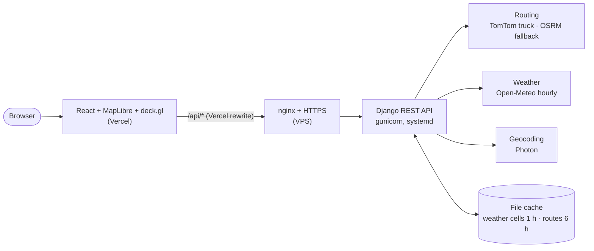
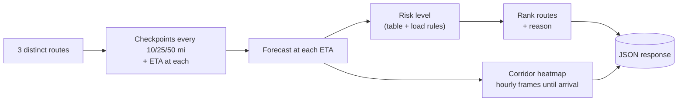

# Weather-Aware Truck Routing

Pick the safest truck route using the forecast **at the time the truck reaches each checkpoint**, the load weight and
the travel time.

**Live app:** https://weather-aware-truck-routing-henna.vercel.app ·
**Demo with a storm:** [`?demo=storm`](https://weather-aware-truck-routing-henna.vercel.app/?demo=storm) ·
**API health:** https://truck-routing.31-97-230-124.sslip.io/api/health

## Try it in a minute

1. Open the app. Chicago → Denver (42,000 lb) is planned automatically.
2. Tick **Demo storm**. The fastest route now crosses No Travel weather, and the recommendation switches to a safer route
   and says why.
3. Press **▶ Play** to watch the trucks and the weather move. Click a route card or checkpoint row to zoom in.

## Architecture



One request, `POST /api/trips/plan`, does the whole plan:



The heatmap's hourly frames all arrive in that one response, so the timeline slider never makes another request.

## How each requirement is met

| Brief | Implementation |
|---|---|
| Origin, destination, departure, load | Form with place autocomplete (or the best match for whatever is typed); departure up to 3 days ahead; 0–80,000 lb |
| 3 route options from a routing API | TomTom (truck profile) or OSRM. Missing alternatives are generated through interstate towns, and near-duplicates, detours and loops are filtered out |
| Weather every 10 / 25 / 50 mi at the ETA | Checkpoints at each interval plus the destination. ETA = departure + drive time to that mile; weather is the hourly forecast for that ETA |
| Risk from the risk and load rules | `backend/trips/domain/risk.py`, with boundary tests for every band |
| Recommend best route (risk vs time) | Ranked by the brief's order, with a one-line reason |
| Routes, checkpoints, risk, ETAs, summaries on a map | Route cards, risk-coloured route, checkpoint hover and table, zoom on click |
| Corridor heatmap + 0–48 h slider | Smooth heatmap of risk, wind, rain or snow; the slider runs from departure to the last arrival |

## Decisions where the brief was open

| Decision | Why |
|---|---|
| Shared band edges (e.g. 0.25 in/hr) go to the **higher** band | Safer; wind's "≥55" sets the pattern. Rain and snow No Travel stay strictly above 1.00 / 3.0, as written |
| A checkpoint's level = **worst** of wind, rain, snow | One dangerous condition is enough |
| Load rules adjust **wind** only | That's what the brief specifies |
| **Sustained** wind sets the level; gusts are shown | The table is in sustained mph |
| Rain = Open-Meteo `rain` + `showers` | Both are liquid precipitation per hour |
| Each checkpoint covers the road **halfway to its neighbours** | Every mile is counted exactly once, so Severe and High miles add up to the route length |
| Ranking: **No Travel** miles → Severe → High → average risk → time | The brief's order. No Travel isn't listed, but it's worse than Severe, so it goes first |
| Average risk is **mile-weighted** (Low 0 … No Travel 4) | Long risky stretches count more than short ones |
| The reason names the fastest route when it loses | Makes the risk vs time trade-off explicit |
| Slider runs to the **last truck's arrival** (not a fixed 48 h) | Covers the whole trip; long trips extend it, up to 96 h |
| Departures up to **3 days ahead** | Hourly forecasts beyond that are unreliable; miles past the forecast are marked unknown, never guessed |
| Weather snapped to a **0.1° grid** and cached per hour | Stays within Open-Meteo's free limits (10,000 calls/day); overlapping routes share cells |
| **Demo storm** mode | Real weather is often calm. It's added on top of the real forecast on the selected route (the fastest by default), clearly labelled, and runs through the same rules |
| No database | The app is stateless; only the cache persists |

## Run locally

```bash
cd backend && uv sync && uv run pytest && uv run python manage.py runserver 127.0.0.1:8000
cd frontend && npm install && npm run dev        # http://localhost:5173, proxies /api to :8000
```

Optional: set `TOMTOM_API_KEY` in `backend/.env` (see `.env.example`) for truck routing with weight and traffic.
Without it, OSRM is used with speeds capped at 65 mph.

## Project structure

```
backend/trips/
  domain/risk.py         risk bands + load rules
  domain/analysis.py     checkpoints, ETAs, mile attribution, ranking + reason
  domain/demo_storm.py   simulated storm overlay
  domain/geo.py          route geometry, similarity, loop/spur detection
  domain/heatmap.py      corridor grid sized to the trip
  providers/             routing, weather (grid + cache), geocoding
  services.py            plans a trip and shapes the response
frontend/src/
  components/TripMap.tsx           map layers and camera
  components/TimelineControls.tsx  timeline slider and playback
  lib/heatmapRaster.ts             grid → smooth image, blended between hours
deploy/                            systemd, nginx and deploy scripts
```

## Deployment

- **Frontend:** Vercel. `vercel.json` forwards `/api/*` to the backend. Deploy with `deploy/deploy-frontend.sh`.
- **Backend:** VPS. gunicorn runs under systemd (capped at 512 MB and half a CPU) behind nginx with Let's Encrypt.
  Update with `deploy/deploy.sh`.

## Known limits

- Driver hours-of-service breaks aren't added to ETAs.
- Without a TomTom key, routing uses a car profile, so truck restrictions (height, weight, hazmat) aren't applied.
